<picture><source media="(prefers-color-scheme: dark)" srcset="graph/top-dark.svg"><source media="(prefers-color-scheme: light)" srcset="graph/top-light.svg"></picture> <a href="https://github.com/Vemloir/LumenLLM"><picture><source media="(prefers-color-scheme: dark)" srcset="graph/p0-dark.svg"><source media="(prefers-color-scheme: light)" srcset="graph/p0-light.svg"></picture></a><a href="https://github.com/Vemloir/qwen3.8-flash-next-sc-quant"><picture><source media="(prefers-color-scheme: dark)" srcset="graph/p1-dark.svg"><source media="(prefers-color-scheme: light)" srcset="graph/p1-light.svg"></picture></a><a href="https://github.com/Vemloir/Varmlen-Client-Linux"><picture><source media="(prefers-color-scheme: dark)" srcset="graph/p2-dark.svg"><source media="(prefers-color-scheme: light)" srcset="graph/p2-light.svg"></picture></a><a href="https://github.com/Vemloir/AegisVPN"><picture><source media="(prefers-color-scheme: dark)" srcset="graph/p3-dark.svg"><source media="(prefers-color-scheme: light)" srcset="graph/p3-light.svg"></picture></a> <picture><source media="(prefers-color-scheme: dark)" srcset="graph/c_left-dark.svg"><source media="(prefers-color-scheme: light)" srcset="graph/c_left-light.svg"></picture><a href="https://github.com/Vemloir/Varmlen-Client-Linux"><picture><source media="(prefers-color-scheme: dark)" srcset="graph/c0-dark.svg"><source media="(prefers-color-scheme: light)" srcset="graph/c0-light.svg"></picture></a><a href="https://github.com/Vemloir/Varmlen-Client-Windows"><picture><source media="(prefers-color-scheme: dark)" srcset="graph/c1-dark.svg"><source media="(prefers-color-scheme: light)" srcset="graph/c1-light.svg"></picture></a><a href="https://github.com/Vemloir/Varmlen-Client-Android"><picture><source media="(prefers-color-scheme: dark)" srcset="graph/c2-dark.svg"><source media="(prefers-color-scheme: light)" srcset="graph/c2-light.svg"></picture></a><picture><source media="(prefers-color-scheme: dark)" srcset="graph/c_right-dark.svg"><source media="(prefers-color-scheme: light)" srcset="graph/c_right-light.svg"></picture>

#### [LumenLLM](https://github.com/Vemloir/LumenLLM)

**Rust + CUDA** inference engine for NVIDIA Blackwell (SM120), built to MoE models on a single GPU. Native NVFP4/FP8, hand-written kernels, explicit VRAM/RAM placement per component. On an RTX 5070 Ti it **beats vLLM** on decode and prefill for models that fit — and runs several vLLM OOMs on outright.

#### [Qwen3.8-Flash-Next SC quant](https://github.com/Vemloir/qwen3.8-flash-next-sc-quant)

Self-calibrated **EXL3** 4.05 bpw quant of Qwen3.8-Flash-Next ([weights on Hugging Face](https://huggingface.co/Vemloir/Qwen3.8-Flash-Next-sc-exl3)): calibration data generated by the model itself in coding-agent sessions, chats at four reasoning levels and on images, a measured bit split in the MoE experts, per-expert affinity-weighted Hessians. At the same size it is **12-17% closer to BF16** (KL divergence) than turboderp's 4.05 bpw quant on two independent traces. Calibration data is open under ODbL.

#### [Varmlen](https://github.com/Vemloir/Varmlen-Client-Linux)

Open-source **xray-core** VPN clients ([Linux](https://github.com/Vemloir/Varmlen-Client-Linux) · [Windows](https://github.com/Vemloir/Varmlen-Client-Windows) · [Android](https://github.com/Vemloir/Varmlen-Client-Android)) with per-app/per-domain split tunneling, built on Tauri 2 + SvelteKit.

#### [Aegis VPN](https://github.com/Vemloir/AegisVPN)

Production VPN subscription platform on **Xray (VLESS + Reality)** and **Hysteria2**, live at [aegisvpn.org](https://aegisvpn.org). Every node pulls signed config over outbound HTTPS and reconciles itself — **no inbound port open** on any exit server.
